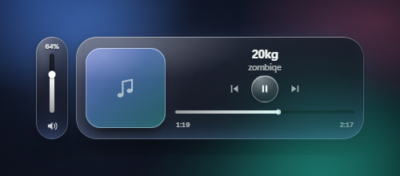

# Aeri

Мини-плеер поверх всех окон в стиле **liquid glass** для Windows. Появляется, когда вы меняете трек или ставите музыку на паузу, и показывает обложку, название, прошедшее время и длительность, перемотку и громкость.



## Что умеет

- Всплывает при **смене трека** и при **паузе**.
- Лёгкий **liquid glass**: полупрозрачные панели, блики, светящиеся кромки и мягкая глубина без размытия фона и тяжёлых эффектов. Стиль можно выключить в меню трея.
- Смена трека сопровождается аккуратной анимацией обложки, названия и светового блика внутри панели.
- Пока курсор находится на виджете, он не закрывается; после ухода исчезает через **2 секунды**. Если не наводить курсор, скрывается через ~4,5 секунды.
- Обложка слева, название и исполнитель — по центру свободной части, под ними — кнопки **play/pause, предыдущий/следующий трек**.
- Компактная полоса перемотки, под ней — **прошедшее время и общая длительность трека**.
- Громкость вынесена в отдельную вертикальную панель рядом с плеером.
- Перемотка: клик или перетаскивание по полоске, плюс **колесо мыши с шагом 1 секунда**.
- Громкость: клик или перетаскивание ползунка, плюс **колесо мыши** (шаг 2%). При наведении показывается процент; клик по иконке выключает звук.
- Плеер можно **перетаскивать за обложку, заголовок или свободную область панели**: окно следует за курсором без рывков, а после отпускания плавно притягивается к ближайшему углу и запоминает его. В правых углах полоска громкости находится слева от плеера, в левых — справа. Кнопки и ползунки при этом остаются кликабельными.
- Иконка в трее: показать виджет заново, включить/выключить **Liquid glass** (правый клик) или выйти. Настройка сохраняется между запусками.

## Запуск

Готовая сборка лежит здесь:

```
release\Aeri-win32-x64\Aeri.exe
```

В корне проекта также лежит готовый ярлык `Aeri.lnk`. Запустите его или сам `Aeri.exe`. Приложение живёт в трее и не занимает панель задач. Чтобы открыть виджет вручную, кликните по иконке в трее или запустите exe ещё раз.

Чтобы приложение запускалось вместе с Windows, положите ярлык на `Aeri.exe` в папку автозагрузки (`Win+R` → `shell:startup`).

## Управление

| Действие | Результат |
|---|---|
| Навести на виджет | виджет остаётся открытым |
| Убрать курсор | закрытие через 2 секунды |
| Потянуть за обложку, заголовок или пустую область | перетаскивание; после отпускания — плавный магнит к ближайшему углу |
| Кнопка play/pause в круге | поставить на паузу / продолжить |
| Стрелки влево и вправо | предыдущий / следующий трек |
| Колесо над полоской трека | перемотка на 1 секунду |
| Потянуть/кликнуть по полоске | перемотка на выбранную позицию |
| Колесо над иконкой громкости или ползунком | громкость ±2% |
| Потянуть/кликнуть по ползунку громкости | плавная регулировка |
| Навести на громкость | показать проценты |
| Клик по иконке громкости | включить/выключить звук |
| Правый клик по иконке в трее → Liquid glass | включить/выключить стеклянный стиль; выбор сохраняется |

## Совместимость

Виджет использует системные медиа-сессии Windows (GSMTC). Работает с плеерами, которые публикуют трек в систему: Яндекс Музыка, Spotify, Apple Music, AIMP, foobar2000 и другими. Если открыт только браузер, виджет попробует взять вкладку с музыкой/видео. Если несколько плееров открыты одновременно, приоритет отдаётся музыкальным приложениям.

Нужен Windows 11 (рекомендуется) или Windows 10 с работающими системными медиа-контролами.

## Запуск из исходников

Нужны Node.js 22+ и Python 3.11 (для моста, который читает медиа-сессию и громкость Windows).

```powershell
npm install
py -3.11 -m venv .venv
.\.venv\Scripts\python.exe -m pip install -r tools\requirements-bridge.txt
npm start
```

Демо-режим без реального плеера:

```powershell
npm run mock
```

## Сборка exe

```powershell
npm run build:bridge   # собирает native\media-bridge.exe через PyInstaller
npm run build:app      # пакует Electron-приложение в release\
```

`build:bridge` требует Python 3.11 и зависимости из `tools\requirements-bridge.txt`. `build:app` требует `@electron/packager` (устанавливается через `npm install`) и собранный `native\media-bridge.exe`.

## Как это устроено

- `src/` — Electron-приложение: окно без рамки, две панели с лёгким имитированным liquid glass (полупрозрачные градиенты, блики и кромки, без размытия и захвата фона), нативное перетаскивание за свободные зоны, магнит к углам и обработка мыши. Смена трека анимирует только обложку, текст и световой блик внутри панели; время обновляется 4 раза в секунду только пока виджет виден и трек играет.
- `native/bridge.py` — фоновый процесс: Windows GSMTC (обложка, трек, позиция, пауза) и Core Audio (громкость).
- `native/media-bridge.exe` — тот же мост, собранный PyInstaller, чтобы готовой сборке не требовался установленный Python.
- Положение окна хранится в `%APPDATA%\Aeri\window-corner.json`, а настройка Liquid glass — в `%APPDATA%\Aeri\settings.json`, поэтому после перезапуска плеер возвращается в последний выбранный угол с тем же стилем.
- При первом запуске Aeri копирует `window-corner.json` и `settings.json` из папки предыдущей версии `%APPDATA%\glass-player`, если в `%APPDATA%\Aeri` этих файлов ещё нет.

Логи: `%APPDATA%\Aeri\aeri.log`.

Приложение не отправляет данные в сеть и не требует авторизации.
