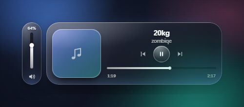

# Aeri

Мини-плеер поверх всех окон в стиле **liquid glass** для Windows. Появляется, когда вы меняете трек или ставите музыку на паузу, и показывает обложку, название, прошедшее время и длительность, перемотку и громкость.



## Скачать

Готовые сборки — в [Releases](https://github.com/brouseeeee/aeri/releases/latest). В релизе два файла:

| Файл | Что это |
|---|---|
| **`Aeri-1.0.0-Setup.exe`** | **Установщик** для Windows x64. Ставит приложение в `%LOCALAPPDATA%\Programs\Aeri`, добавляет ярлык в меню «Пуск» и (по желанию) на рабочий стол, создаёт деинсталлятор. Права администратора не нужны. |
| **`Aeri-1.0.0-portable-win32-x64.zip`** | **Portable-сборка**. Полностью распакуйте архив в любую папку и запустите `Aeri.exe`. Установка не требуется. |

Обе версии используют одни и те же настройки в `%APPDATA%\Aeri`. Установщик и деинсталлятор не удаляют эту папку, поэтому положение виджета и режим Liquid glass сохраняются при переустановке и удалении. Сборки не подписаны, поэтому SmartScreen может показать предупреждение — это ожидаемо.

## Что умеет

- Всплывает при **смене трека** и при **паузе**; поведение автопоказа настраивается в меню трея.
- Лёгкий **liquid glass**: полупрозрачные панели, блики, светящиеся кромки и мягкая глубина без размытия фона и тяжёлых эффектов. Стиль можно выключить в меню трея.
- Стиль **Windows 11** с тёмными полупрозрачными панелями, голубыми элементами управления и крупной обложкой можно выбрать в меню трея; выбранный стиль сохраняется.
- Смена трека сопровождается аккуратной анимацией обложки, названия и светового блика внутри панели.
- Пока курсор находится на виджете, он не закрывается; после ухода исчезает через **2 секунды**. Если не наводить курсор, скрывается через ~4,5 секунды.
- Обложка слева, название и исполнитель — по центру свободной части, под ними — кнопки **play/pause, предыдущий/следующий трек**.
- Компактная полоса перемотки, под ней — **прошедшее время и общая длительность трека**.
- Громкость вынесена в отдельную вертикальную панель рядом с плеером.
- Перемотка: клик или перетаскивание по полоске, плюс **колесо мыши с шагом 1 секунда**.
- Громкость: клик или перетаскивание ползунка, плюс **колесо мыши** (шаг 2%). При наведении показывается процент; клик по иконке (или проценту в стиле Windows 11) выключает звук.
- Плеер можно **перетаскивать за обложку, заголовок или свободную область панели**: окно следует за курсором без рывков, а после отпускания плавно притягивается к ближайшему углу и запоминает его. В правых углах полоска громкости находится слева от плеера, в левых — справа. Кнопки и ползунки при этом остаются кликабельными.
- Изменение системной громкости может автоматически показать виджет с микшером; эту настройку можно отключить в меню трея.
- Иконка в трее: показать виджет, переключить стиль, настроить автопоказ при смене трека и громкости или выйти. В Windows 10 штатная панель громкости скрывается автоматически, пока работает Aeri.
- Виджет использует максимальный уровень поверх окон, в том числе поверх окон в полноэкранном режиме. Эксклюзивный полноэкранный режим некоторых игр/приложений может обходить системные оверлеи Windows.

## Запуск

После сборки (`npm run build:app`) готовая сборка лежит здесь:

```
release\Aeri-win32-x64\Aeri.exe
```

Для удобства создайте ярлык на `Aeri.exe` (в локальной сборке уже есть `Aeri.lnk`). Приложение живёт в трее и не занимает панель задач. Чтобы открыть виджет вручную, кликните по иконке в трее или запустите exe ещё раз.

Если приложение установлено через установщик, запускайте Aeri из меню «Пуск». Portable-сборку запускайте из распакованной папки.

Чтобы приложение запускалось вместе с Windows, положите ярлык на `Aeri.exe` в папку автозагрузки (`Win+R` → `shell:startup`).

## Управление

| Действие | Результат |
|---|---|
| Навести на виджет | виджет остаётся открытым |
| Убрать курсор | закрытие через 2 секунды |
| Потянуть за обложку, заголовок или пустую область | перетаскивание; после отпускания — плавный магнит к ближайшему углу |
| Кнопка play/pause в круге | поставить на паузу / продолжить |
| Стрелки влево и вправо | предыдущий / следующий трек |
| Колесо над полоской трека | перемотка на 1 секунду |
| Потянуть/кликнуть по полоске | перемотка на выбранную позицию |
| Колесо над иконкой громкости или ползунком | громкость ±2% |
| Потянуть/кликнуть по ползунку громкости | плавная регулировка |
| Навести на громкость | показать проценты |
| Клик по иконке громкости или проценту в стиле Windows 11 | включить/выключить звук |
| Правый клик по иконке в трее → Liquid glass | включить/выключить стеклянный стиль; выбор сохраняется |
| Правый клик по иконке в трее → Windows 11 style | переключить на стиль Windows 11; выбор сохраняется |
| Правый клик по иконке в трее → Настройки | включить/выключить автопоказ при смене трека и изменении громкости |

## Совместимость

Виджет использует системные медиа-сессии Windows (GSMTC). Работает с плеерами, которые публикуют трек в систему: Яндекс Музыка, Spotify, Apple Music, AIMP, foobar2000 и другими. Для Яндекс Музыки данные о времени трека читаются без принудительного восстановления её свернутого окна. Если открыт только браузер, виджет попробует взять вкладку с музыкой/видео. Если несколько плееров открыты одновременно, приоритет отдаётся музыкальным приложениям.

Нужен Windows 11 (рекомендуется) или Windows 10 с работающими системными медиа-контролами.

## Запуск из исходников

Нужен Node.js 22+.

```powershell
npm install
npm start
```

Мост `native\media-bridge.exe` уже лежит в репозитории. Python 3.11 нужен только для его пересборки:

```powershell
py -3.11 -m venv .venv
.\.venv\Scripts\python.exe -m pip install -r tools\requirements-bridge.txt
npm run build:bridge
```

При запуске через `npm start` приложение автоматически перезагружает окно при сохранении файлов в `src/renderer/` (`.html`, `.css`, `.js`). Изменения в `src/main.js` требуют перезапуска приложения.

Демо-режим без реального плеера:

```powershell
npm run mock
```

## Сборка exe и установщика

```powershell
npm run build:bridge    # собирает native\media-bridge.exe через PyInstaller
npm run build:app       # пакует Electron-приложение в release\
npm run build:installer # собирает release\Aeri-1.0.0-Setup.exe
```

`build:bridge` требует Python 3.11 и зависимости из `tools\requirements-bridge.txt`. `build:app` требует `@electron/packager` (устанавливается через `npm install`) и `native\media-bridge.exe` (уже лежит в репозитории).

`build:installer` требует [Inno Setup 6](https://jrsoftware.org/isinfo.php) (проверено на 6.7.3) и готовую папку `release\Aeri-win32-x64\`. Установщик собирается по скрипту `tools\installer.iss`, ставится для текущего пользователя в `%LOCALAPPDATA%\Programs\Aeri` и не трогает `%APPDATA%\Aeri`. Если Inno Setup не установлен: `winget install --id JRSoftware.InnoSetup -e`.

В git не попадают `release\`, `build\`, `node_modules\`, `.venv\` и локальные ярлыки — они исключены через `.gitignore`. Собранный `native\media-bridge.exe` хранится в репозитории.

## Скрытие штатной панели громкости Windows 10

В Windows 10 Aeri автоматически скрывает системную панель громкости во время работы. Скрытие реагирует на событие показа окна панели, поэтому не использует периодический опрос.

Для отдельного запуска утилиты из корня репозитория:

```powershell
py .\native\hide_volume_osd.py
```

Утилита работает в фоне, пока запущена; для остановки нажмите `Ctrl+C`. Она не меняет настройки Windows и не запускается вместе с Aeri.

## Как это устроено

- `src/` — Electron-приложение: окно без рамки, две панели с лёгким имитированным liquid glass (полупрозрачные градиенты, блики и кромки, без размытия и захвата фона), нативное перетаскивание за свободные зоны, магнит к углам и обработка мыши. Смена трека анимирует только обложку, текст и световой блик внутри панели; время обновляется 4 раза в секунду только пока виджет виден и трек играет.
- `native/bridge.py` — фоновый процесс: Windows GSMTC (обложка, трек, позиция, пауза) и Core Audio (громкость).
- Для чтения позиции Яндекс Музыки UI Automation использует её слайдер. Если окно свёрнуто, Windows не предоставляет его значения, поэтому Aeri разворачивает окно без активации и оставляет его открытым; повторного сворачивания/разворачивания нет.
- `native/media-bridge.exe` — тот же мост, собранный PyInstaller, чтобы готовой сборке не требовался установленный Python.
- Положение окна хранится в `%APPDATA%\Aeri\window-corner.json`, настройки стиля — в `%APPDATA%\Aeri\settings.json`, поэтому выбор сохраняется после перезапуска.
- При первом запуске Aeri копирует `window-corner.json` и `settings.json` из папки предыдущей версии `%APPDATA%\glass-player`, если в `%APPDATA%\Aeri` этих файлов ещё нет.

## Настройка стилей

В меню трея выберите один стиль: **Liquid glass**, **Windows 11 style** или **Windows 10 style**. Liquid Glass и Windows 11 используют общий шаблон, а Windows 10 загружает отдельную разметку:

- `src/renderer/themes/liquid-glass/` — разметка и стили Liquid Glass.
- `src/renderer/themes/windows-11/` — переопределения стилей Windows 11 для общего шаблона.
- `src/renderer/themes/windows-10/` — разметка, стили, скрипты, шрифт и изображения Windows 10.
- `src/renderer/style.css` и `src/renderer/renderer.js` — базовые стили, раскладка и логика управления шаблонами Liquid Glass и Windows 11.

Для общего шаблона при изменении HTML сохраняйте используемые в `renderer.js` идентификаторы элементов, например `title`, `playButton`, `seek`, `volume` и `volumeButton`. Стили пишите в файле соответствующей темы. Например, `.widget` — панель плеера, `.volume-panel` — панель громкости, `.ctrl` — кнопки.

Логи: `%APPDATA%\Aeri\aeri.log`.

Приложение не отправляет данные в сеть и не требует авторизации.
